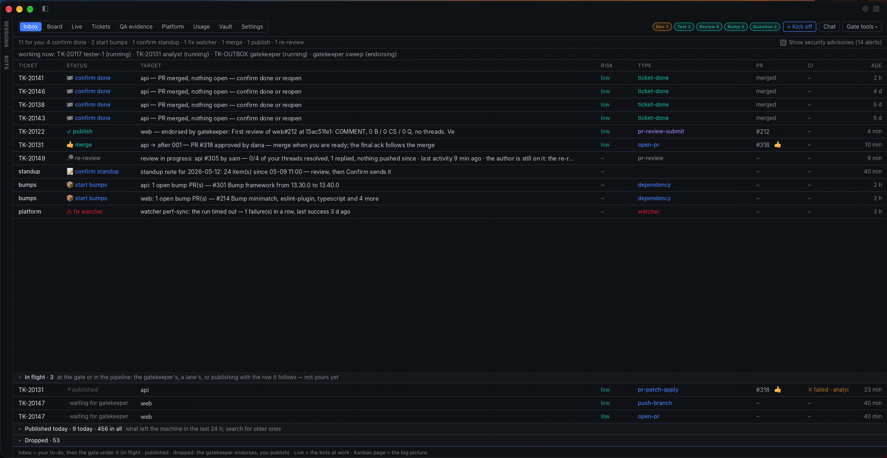
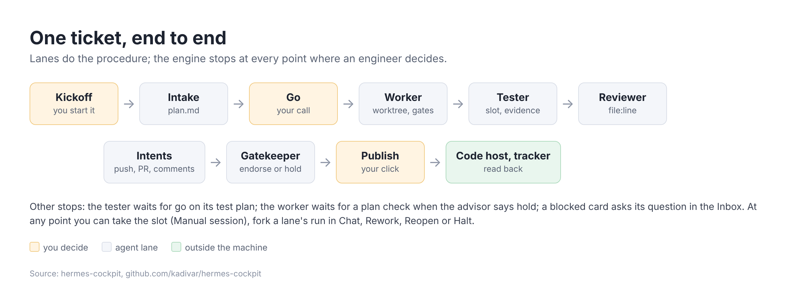
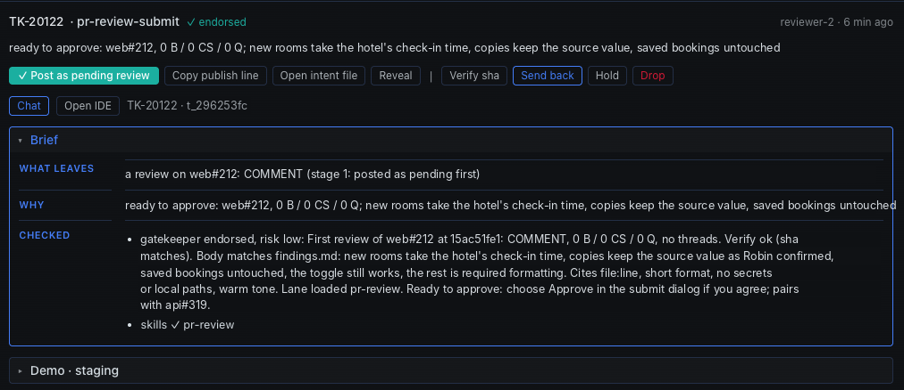
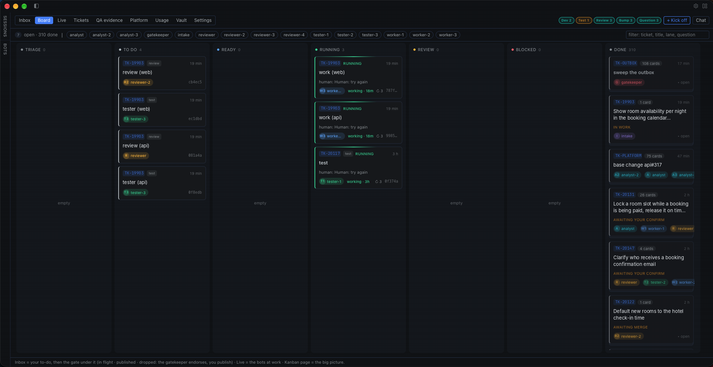
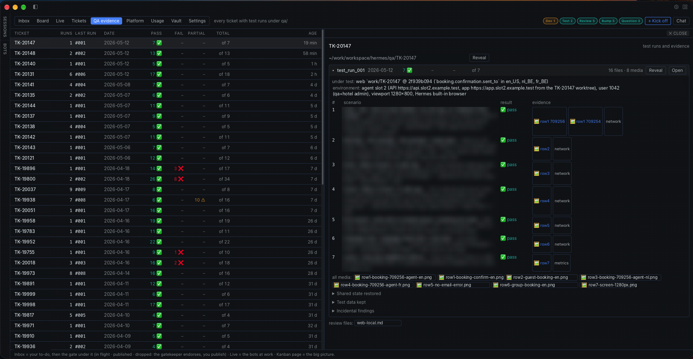
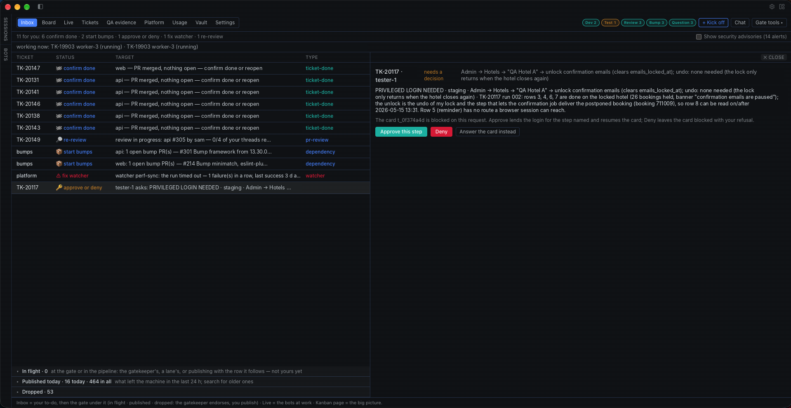

# Cockpit

*Agents do the procedure. You keep the decisions.*

[](https://github.com/kadivar/hermes-cockpit/actions/workflows/ci.yml) [](https://github.com/kadivar/hermes-cockpit/actions/workflows/codeql.yml) [](https://scorecard.dev/viewer/?uri=github.com/kadivar/hermes-cockpit) [](LICENSE) [](#requirements) [](#requirements) [](https://github.com/kadivar/hermes-cockpit/releases)

<p align="center"><br><em>The Inbox: what needs your decision, and nothing else.</em></p>

Cockpit is a plugin for [Hermes](https://github.com/NousResearch/hermes-agent), an agent runtime with tools, a kanban
board and scheduled jobs. It makes your machine a supervised ticket pipeline: agent roles plan, code in a separate git
worktree, test and review. No agent can push, open a pull request or comment; each writes an *intent* into an outbox, a
gatekeeper checks it, and nothing leaves until you click Publish. One *pack* holds repos, tests, URLs and models.



<details><summary>Text version</summary>

```
 ticket
   │
   ▼
 intake ──▶ worker ──▶ tester ──▶ reviewer        agent lanes, each in the ticket's own worktree
   │           │          │           │
   └───────────┴────┬─────┴───────────┘           each writes intents (push, pull request, comment, ...)
                    ▼
                 outbox ──▶ gatekeeper endorses ──▶ the human publishes ──▶ code host / tracker

 egress hook: a push, a code-host write or a production host that does not go through the outbox is refused
```

</details>

## A day with Cockpit

It is for a developer who wants agents to do ticket work and wants to stay the one who ships it.

<table>
<tr><td width="50%" valign="top"><br><sub>See exactly what leaves, and why, before approving.</sub></td><td width="50%" valign="top"><br><sub>Every card and every lane, on one board.</sub></td></tr>
<tr><td width="50%" valign="top"><br><sub>Test evidence you can open, scenario by scenario.</sub></td><td width="50%" valign="top"><br><sub>A 30-minute credential loan, granted only on approval.</sub></td></tr>
</table>

Read the story behind it: [The machine has my back: agents with a human gate](https://medium.com/@kadivar/agents-with-a-human-gate-9dae50584960).

## Quickstart


To see it work in a minute, before you connect anything: `cockpit demo gate` plays one ticket through the gate in a
sandbox, with no Hermes, no account and no tracker ([docs/demo.md](docs/demo.md)).

From your workspace folder (the one that holds, or sits beside, your repositories):

```sh
cockpit init --no-production           # prints what it found and the files it would write; writes nothing
cockpit init --no-production --write   # writes cockpit-pack/ from the starter pack, then binds the workspace
cockpit setup     # creates the seats, the board, the scheduled jobs and the gateway
cockpit doctor    # "doctor: OK", or each error and warning with the line that resolves it
```

`init` asks nothing and never guesses what production is: a project that has one names each host with
`--production-host 'app\.example\.test'` in place of `--no-production`.

[docs/quickstart.md](docs/quickstart.md) walks through each step with what you should see.

## Requirements

- **Hermes** 0.22.2 or newer. Cockpit was checked against Hermes 0.22 and 0.23; `cockpit doctor` accepts a newer minor
  only when a live probe of its hooks passes, and refuses an older one.
- **Linux or macOS.** Windows is not supported: the chat terminal needs a pseudo-terminal and the scheduled jobs are
  shell scripts.
- **Python** 3.11 or newer, with PyYAML (the plugin's own virtual environment provides it, see below).
- **git**, and the code host's command line (`gh`), signed in as you.
- **A tracker**: Jira, GitHub Issues, or your own through a command.
- **GPG** with a public key, for the vault that holds the lanes' test logins.
- **ffmpeg** and **ffprobe**, for the video a tester records of a failed scenario.

## Install

```sh
hermes plugins install https://github.com/kadivar/hermes-cockpit
```

That command does not put `cockpit` on your `PATH`. The program is `~/.hermes/plugins/cockpit/bin/cockpit`; setup also
links it as `~/.hermes/bin/cockpit`, so add that folder when you want the short name:

```sh
export PATH="$HOME/.hermes/bin:$PATH"
```

If the machine's `python3` has no PyYAML, give the plugin its own interpreter once:
`cd ~/.hermes/plugins/cockpit && python3 -m venv .venv && .venv/bin/pip install -e .`

Enable **cockpit** in Hermes (`plugins.enabled`; in the Desktop: Capabilities → Plugins → Rescan → switch Cockpit on).

## What stays human, and how it stays safe

- **The outbox is the only door the kernel offers.** A lane writes an intent; the gatekeeper endorses or holds it; only
  you publish, drop, or apply an update. A lane's own attempt at any of those is refused. (A pack can opt one scope
  into publishing without the click; it is off by default.)
- **What you approve is what leaves.** An endorsement records the digest of each drafted file, and a publish refuses a
  draft that changed since.
- **The egress hook fails closed.** It refuses pushes, code-host writes, production hosts and vault files, and a pack can
  add denies but cannot remove the kernel's.
- **Secrets stay out of sight.** A stored login never goes into a command line, a log or a tool result, and known secrets
  are masked in what a lane reads (exact match, best effort).
- **It is not a sandbox.** Lanes run as you, with your logins. The gate and the fence stop accidents and well-behaved
  agents; they do not contain a hostile or prompt-injected agent that can run arbitrary programs as your user. For
  stronger isolation run the whole installation as a separate OS user or in a container.

The full model, including every network destination the kernel contacts, is in [docs/security.md](docs/security.md).

## Customizing

Everything team-specific lives in the pack, not in the plugin. [docs/customize/](docs/customize/README.md) has one recipe
per extension point: [repo gates](docs/customize/repo-gates.md), [verify commands](docs/customize/verify-commands.md),
[slot runtime](docs/customize/slot-runtime.md), [helpers](docs/customize/helpers.md),
[notifications](docs/customize/notifications.md), [egress rules](docs/customize/egress-rules.md),
[seats and souls](docs/customize/seats-and-souls.md), [a tracker by command](docs/customize/tracker-command.md), and more.
Every pack key is in [docs/reference/pack-keys.md](docs/reference/pack-keys.md). A first pack starts from the
[starter pack](starter/README.md): generic skills, a common soul and one working script per command contract.

## Documentation

| Read | For |
|---|---|
| [docs/concepts.md](docs/concepts.md) | the words: pack, lane, seat, intent, outbox, gate, slot, and the flow |
| [docs/quickstart.md](docs/quickstart.md) | day 0, step by step |
| [docs/security.md](docs/security.md) | trust boundaries, invariants, outbound destinations |
| [docs/customize/](docs/customize/README.md) | one recipe per extension point |
| [docs/operations/](docs/operations/) | [setup and doctor](docs/operations/setup-and-doctor.md) (with `cockpit pack effective`, `pack explain` and `describe`), [vault](docs/operations/vault.md), [publishing without a click](docs/operations/unattended-publishing.md), [browser and recording](docs/operations/browser-and-recording.md), [updating](docs/operations/update.md) (`cockpit update apply` and `rollback`), [worktrees](docs/operations/worktrees.md), [pinning defaults](docs/operations/pinning.md) (`cockpit pack pin`), [migrating](docs/operations/migrating.md), [replay](docs/operations/replay.md) |
| [docs/desktop-pages.md](docs/desktop-pages.md) | what each page shows and reads |
| [docs/plugins.md](docs/plugins.md) | another Hermes plugin beside cockpit |
| [docs/reference/](docs/reference/) | generated: [pack keys](docs/reference/pack-keys.md), [commands](docs/reference/cli.md), [intents](docs/reference/intents.md), [events](docs/reference/events.md), [doctor](docs/reference/doctor.md), [plugin API](docs/reference/plugin-api.md) |
| [docs/contributing/architecture.md](docs/contributing/architecture.md) | the repo map and how to add a key, a command, a route, a view |
| [CHANGELOG.md](CHANGELOG.md), [SUPPORT.md](SUPPORT.md), [CODE_OF_CONDUCT.md](CODE_OF_CONDUCT.md) | changes, questions, conduct |

## Contributing

There is no issue tracker: a report is a pull request, usually a failing test.
Point your coding assistant at [AGENTS.md](AGENTS.md); it carries the rules and the checks.
A vulnerability goes through [SECURITY.md](SECURITY.md), never a public pull request.

## Status and license

Version 0.1, before 1.0, with one maintainer. Before 1.0 a pack key may change; the changelog lists each
change with what to write instead.

Cockpit is open source under the GNU Affero General Public License, version 3 or any later version
(`AGPL-3.0-or-later`): see [LICENSE](LICENSE) and [NOTICE](NOTICE). Commercial licences are available on request: see
[COMMERCIAL.md](COMMERCIAL.md).
